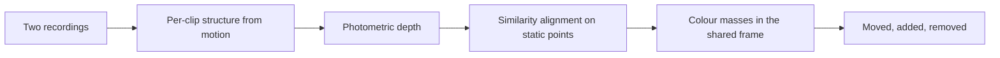

# Spatial change, from two phone recordings

Compare two walks through the same small indoor space. The tool builds one shared 3D scene, then says what was moved, added, or removed, in colour and in plain language.

There is no real-time requirement. The interesting part is the shared geometry and a description a person can check against the videos.

## What you get

A run writes:

| File | What it is |
| --- | --- |
| `report.md` / `report.json` | The changes, in sentences and as structured data |
| `scene_before.ply`, `scene_after.ply`, `changes.ply` | The shared scene and the changed regions |
| `preview.png` | Both recordings, a top-down map, and the summary |
| `viewer.html` | Three orthographic views you can open from disk. Tick the layers to show or hide each cloud |

On the included synthetic room the report is: the red object moved, the blue object was removed, and a green object appeared.

## Open the studio

```bash
python -m spatial_change ui
```

A page opens on this computer. Drop the earlier recording and the later one, set the phone's vertical field of view if you know it, and build the shared map. The same page can run the synthetic room, which is scored against the known move, removal, and addition. A comparison takes about a minute. Nothing leaves the machine.

## Run the demo

```bash
pip install -r requirements.txt
python -m spatial_change demo --out runs/demo
```

That renders two short clips of a room (one object moves, one leaves, one arrives), reconstructs both, and scores the result against the known changes. Open `runs/demo/preview.png` and `runs/demo/viewer.html`.

## Run it on your own recordings

Film the same corner twice, walking a short arc so the camera translates as well as turns. Keep the phone upright. Then:

```bash
python -m spatial_change run --before before.mp4 --after after.mp4 --out runs/room
```

If you know the camera, pass intrinsics:

```json
{"fx": 1200, "fy": 1200, "cx": 540, "cy": 960, "width": 1080, "height": 1920}
```

```bash
python -m spatial_change run --before before.mp4 --after after.mp4 --out runs/room --intrinsics phone.json
```

Without that file the tool assumes a vertical field of view of 62 degrees, which is typical for a phone's main camera. `--fov` overrides it. Frames are sampled (default 12) and scaled so the long side is at most 960 pixels.

On a real recording the picture marks come from open-set models, not from colour blobs. Grounding DINO proposes bottles, curtains, and the other indoor objects. SAM 2 tightens each box onto the object. DINOv2 decides whether that crop is the same thing in the other visit. SigLIP checks the label. A box is drawn only on the frame where that object was detected, so the mark sits on the object you can see.

## How it works



1. **Sparse map.** SIFT tracks and incremental pose estimation turn each clip into a cloud. The first baseline sets the scale so the median depth is about 2 m. Both clips are therefore in approximate metres before they are aligned to each other.
2. **Dense surfaces.** Between neighbouring frames, each pixel is tested at many depths. A depth is kept when that pixel matches the other frame, the match is clearly better than other depths, and it agrees with the surrounding surface and with a third view.
3. **One coordinate frame.** 3D points that describe the same place in both maps (the parts that did not move) estimate a similarity: scale, rotation, and translation. That places the second cloud into the first. The scene is then rotated so "up" follows the cameras.
4. **What changed.** Saturated points are grouped by colour. A colour present in both recordings, whose centre has shifted, is a move. A colour that is present in only one recording was added or removed. Floor and wall colours do not shift, so they are not reported.

The language places each change relative to the static scene: left or right, front or back, and high or low.

## Layout

```
spatial_change/
  synth.py       synthetic room, for the demo and the score
  sfm.py         sparse reconstruction
  dense.py       photometric depth
  geometry.py    similarity alignment and cameras
  changes.py     colour, move / add / remove, sentences
  pipeline.py    wires the stages and writes the outputs
  viz.py         PLY, preview image, offline viewer
tests/           alignment, cameras, and the three change types
```

## Limits

- One object per colour. Two red objects are reported as a single red change.
- The metre scale is a prior (median depth of 2 m), then a similarity. Distances are approximate.
- The walk needs texture and parallax. A slow pan of a blank wall will not build a map.
- Thin objects, and objects that barely rise off the surface behind them, are harder than a box on a table.
- The viewer draws the clouds in the page. It does not need a server. The pictures in `preview.png` do not need a network connection either.

## Tests

```bash
python -m unittest tests.test_geometry tests.test_changes -v
```
